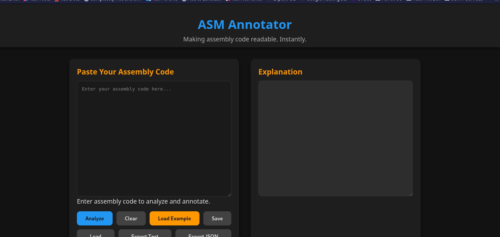

# Assembly Annotator

**Assembly Annotator** is a web-based tool that makes assembly code readable and understandable through line-by-line annotation, pattern detection, and advanced analysis features.  

It’s designed for reverse engineers, developers, and learners who want to analyze, document, or better understand assembly code.

---

## Table of Contents

- [Features](#features)
- [Why Use Assembly Annotator](#why-use-assembly-annotator)
- [Screenshots](#screenshots)
- [Installation](#installation)
- [Usage](#usage)
- [Code Structure](#code-structure)
- [Extending the Tool](#extending-the-tool)
- [Testing](#testing)
- [Contributing](#contributing)
- [License](#license)
- [References](#references)

---

## Features

### Instruction Explanations
- Clear, human-readable explanations for hundreds of assembly instructions.
- Includes usage examples and references to official documentation.

### Multi-Dialect and Multi-Architecture Support
- Supports Intel and AT&T syntaxes.
- Works with x86, ARM, and MIPS architectures.
- Automatic detection of dialect and architecture for accurate annotation.

### Advanced Pattern Detection
- Detects function prologues/epilogues, stack setups, password checks, loops, and conditional jumps.
- Flags reverse engineering idioms, anti-debugging tricks, and obfuscation patterns.
- Uses regex-based matching for customizable detection.

### Export and Import
- Export annotated code as JSON, HTML, or PDF.
- Import previous analysis files to continue work or share.

### Interactive User Interface
- Syntax highlighting for code input and annotated output.
- Clickable explanations with cross-references.
- User customization for verbosity, pattern sets, and themes.
- Responsive design with smooth UX.

### Integration and Extensibility
- Plugin architecture and API hooks.
- Connect with popular disassemblers and debugging tools.
- Extend functionality with custom scripts or plugins.

### Performance Optimizations
- Efficient backend processing to handle large assembly files.
- Optimized rendering for responsiveness even with large outputs.

### Security-Focused Analysis
- Detects suspicious or potentially malicious code patterns.
- Aids reverse engineers in identifying malware-like behavior.

---

## Why Use Assembly Annotator

- Quickly understand cryptic assembly instructions.
- Detect common and advanced patterns automatically.
- Supports multiple architectures and dialects.
- Save, share, and document your analysis.
- Designed for both learners and professionals.

---

## Screenshots



---

## Installation

### Prerequisites
- Python 3.7 or higher
- pip package manager

### Setup Steps

```bash
git clone https://github.com/zoecyber001/assembly-annotator.git
cd assembly-annotator
```

(Optional but recommended)

```bash
python3 -m venv venv
source venv/bin/activate  # On Windows: venv\Scripts\activate
```

Install dependencies:

```bash
pip install -r requirements.txt
```

Run the application:

```bash
python app.py
```

Open your browser and navigate to:

```
http://127.0.0.1:5000/
```

---

## Usage

1. Paste or type your assembly code in the input area.

2. Select the assembly dialect and architecture if needed.

3. Click Analyze to generate line-by-line annotations and detect patterns.

4. Review explanations and detected patterns in the output panel.

5. Export results as JSON, HTML, or PDF.

6. Import previously saved annotated files to continue analysis.

---

## Code Structure

- `app.py` – Flask backend handling annotation, pattern detection, and export.

- `templates/` – HTML templates for the frontend UI.

- `static/`
  - `style.css` – UI styling.
  - `script.js` – Frontend logic and API calls.

- `requirements.txt` – Python dependencies.

---

## Extending the Tool

- Add new instruction explanations by editing the `EXPLANATIONS` dictionary in `app.py`.

- Define or update patterns in the `PATTERNS` list with keywords or regex.

- Customize the UI by editing HTML, CSS, and JavaScript.

- Extend the backend API for integration with other tools.

---

## Testing

- Backend API endpoints: test with curl, Postman, or other tools.

- Frontend UI: test manually by interacting with the interface.

- Automated tests: recommended using pytest (backend) and frameworks like Jest (frontend).

---

## Contributing

Contributions are welcome!

- Fork the repository.

- Create a feature branch.

- Submit a pull request with a clear description of your changes.

---

## License

This project is licensed under the MIT License. See the LICENSE file for details.

---

## References

- [Intel 64 and IA-32 Architectures Software Developer’s Manual](https://software.intel.com/content/www/us/en/develop/articles/intel-sdm.html)
- [Felix Cloutier’s x86 Instruction Reference](https://www.felixcloutier.com/x86/)
- [ARM Architecture Reference Manual](https://developer.arm.com/documentation/ddi0100/latest)
- [MIPS Architecture Reference](https://www.mips.com/develop/tools/architecture/)
