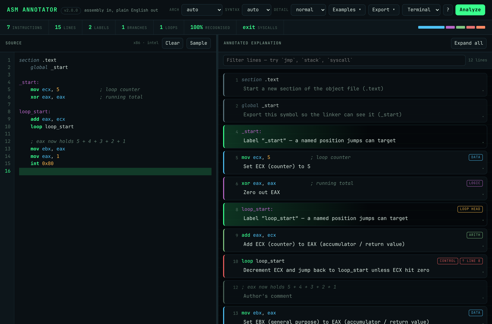
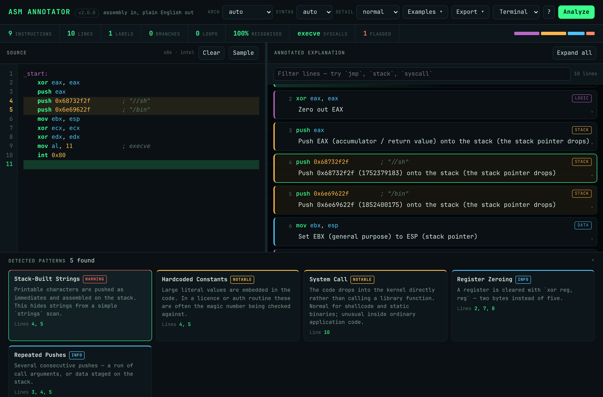
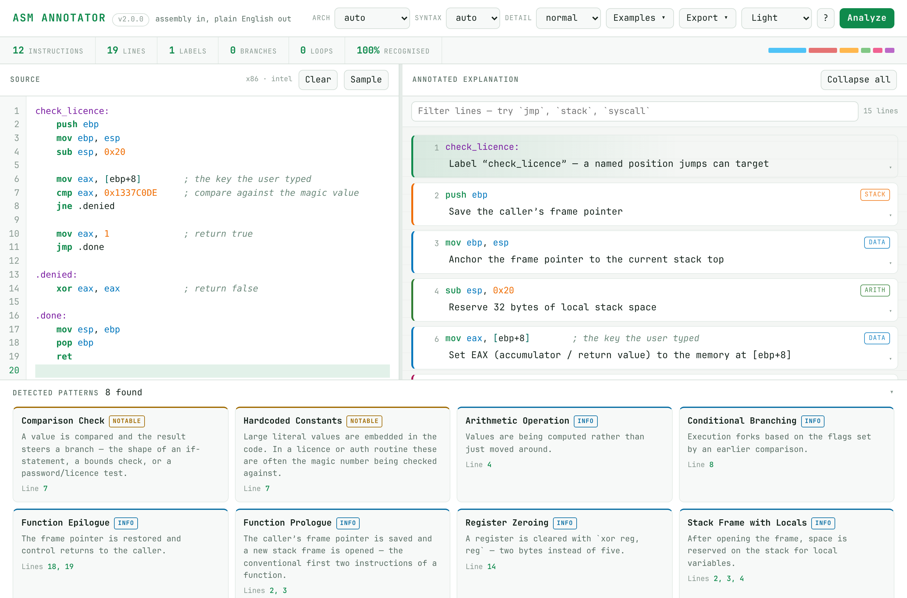

# Assembly Annotator

Paste assembly, read plain English.

Assembly Annotator explains a listing line by line, names the patterns it finds,
and resolves the branches between them. It is aimed at reverse engineers, CTF
players, students and anyone who has stared at a disassembly wondering what it
actually *does*.



---

## What it does

**Every line gets a sentence, not a dictionary entry.** The explanation is built
from the operands, so `mov ecx, 5` reads *"Set ECX (counter) to 5"* rather than
"copy data from source to destination". Labels, directives and comments are
classified as what they are instead of being reported as unknown instructions.

**Idioms are named.** `xor eax, eax` is *"Zero out EAX"*. `sub esp, 0x20` is
*"Reserve 32 bytes of local stack space"*. `shl eax, 3` is *"Multiply EAX by 8"*.
`test eax, eax` is *"Check whether EAX is zero"*.

**Constants are followed forward.** A light register model propagates immediates
through the listing, so by the time it reaches `int 0x80` it knows EAX held 4 and
reports *"Invoke the write() system call"*. Packed immediates are decoded too —
`push 0x6e69622f` is flagged as the ASCII text `/bin` being assembled on the stack.

**Patterns come with reasons.** Each detection carries a plain-English
description, a severity, and the exact lines that triggered it. Click a pattern
to highlight those lines in both panes.



**Branches resolve.** Jump targets are matched to the lines that define them, so
every branch shows where it goes, backward jumps are marked as loops, and code
nothing reaches is flagged as unreachable.

---

## Input it understands

| Input | Notes |
| --- | --- |
| x86 / x86-64 | 210+ mnemonics including the full `jcc` / `setcc` / `cmovcc` families |
| ARM / AArch64 | prologue pairs, `svc` system calls, conditional branches |
| MIPS | core integer and branch instructions |
| Intel syntax | `mov eax, 1` |
| AT&T syntax | `movl $1, %eax` — operands are flipped so explanations read the same way |
| objdump / gdb | addresses, opcode bytes and `<function>:` headers are parsed and dimmed |
| NASM / GAS | sections, `global`, data definitions, `;` `#` and `//` comments |

Architecture and syntax are auto-detected; both can be forced from the toolbar.

---

## Interface

- **Split view** — editable source on the left with line numbers and syntax
  highlighting, annotations on the right, draggable divider.
- **Three detail levels** — *brief* for a quick pass, *normal*, or *verbose*,
  which adds tracked register values and flag effects.
- **Filter** — type `jmp`, `stack` or `syscall` to narrow the annotations.
- **Four themes** — terminal, midnight, amber and light.
- **Export** — Markdown report, aligned plain text, full JSON (including the
  control-flow graph), or copy to the clipboard.
- **Keyboard** — <kbd>Ctrl</kbd>+<kbd>Enter</kbd> analyze,
  <kbd>Ctrl</kbd>+<kbd>K</kbd> filter, <kbd>Ctrl</kbd>+<kbd>/</kbd> expand all.
- **Eight worked examples** in the Examples menu, from a counted loop to
  `execve` shellcode to raw objdump output.



The front end is plain HTML, CSS and JavaScript — no framework, no CDN, no build
step. Nothing you paste leaves your machine beyond the local Flask process, and
nothing is stored server-side.

---

## Running it

```bash
git clone git@github.com:yallcbyte/assembly-annotator.git
cd assembly-annotator
./run.sh
```

Then open <http://127.0.0.1:5000>. `run.sh` creates a virtualenv on first run.

Manually, if you prefer:

```bash
python3 -m venv .venv
.venv/bin/pip install -r requirements.txt
.venv/bin/python app.py          # PORT=8080 to change the port
```

Requires Python 3.9+ and Flask.

---

## Tests

```bash
pip install -r requirements-dev.txt
python -m pytest
```

90 tests cover parsing, explanation, pattern detection, control flow and the
HTTP API, including a check that every bundled example is fully recognised.

---

## HTTP API

| Method | Path | Purpose |
| --- | --- | --- |
| `POST` | `/api/annotate` | Analyze a listing. Body: `{code, arch?, syntax?, verbosity?}` |
| `POST` | `/api/export/{md,txt,json}` | Same analysis as a downloadable report |
| `GET` | `/api/examples` · `/api/examples/<id>` | Bundled examples |
| `GET` | `/api/instruction/<mnemonic>` | Instruction reference entry |
| `GET` | `/api/register/<name>` | Register role, width and parent |
| `GET` | `/api/health` | Status and database size |

```bash
curl -s localhost:5000/api/annotate \
  -H 'Content-Type: application/json' \
  -d '{"code":"xor eax, eax\nmov al, 11\nint 0x80"}' | jq '.stats.syscalls'
# ["execve"]
```

---

## Code layout

```
annotator/
  parser.py      line classification: labels, directives, comments, objdump, AT&T
  isa.py         instruction database, categories, condition codes
  registers.py   register roles, widths and 64-bit parents
  syscalls.py    Linux x86 / x86-64 / AArch64 syscall tables
  explain.py     operand-aware sentences, idiom recognition, register tracking
  patterns.py    pattern engine with severities and line evidence
  cfg.py         branch resolution, loop headers, unreachable code
  analyzer.py    orchestration and summary statistics
  examples.py    bundled sample listings
app.py           Flask routes and report rendering
static/          one stylesheet, one script
templates/       one page
tests/           90 tests
```

### Adding an instruction

```python
# annotator/isa.py
'adcx': _i('Add with carry (unsigned)', 'arith',
           'Add the source plus the carry flag, unsigned',
           'Add {src} plus the carry flag to {dst}', 'CF',
           'Used in wide-integer arithmetic alongside ADOX.'),
```

`{dst}`, `{src}` and `{op0}`…`{op3}` are filled from the parsed operands.

### Adding a pattern

```python
# annotator/patterns.py
Pattern('my_check', 'Human-readable Name',
        'What the reader should take away from this.',
        'notable', 'control', any_of=['cmp', 'test']),
```

Patterns match on an ordered `sequence`, `all_of`, `any_of`, a `regex`, or a
`custom` callable that receives the match context and returns line numbers.

---

## Credit

Forked from [zoecyber001/assembly-annotator](https://github.com/zoecyber001/assembly-annotator),
originally made for the Cybersecurity Committee by ZoeCyber.

## Licence

MIT — see [LICENSE](LICENSE).
